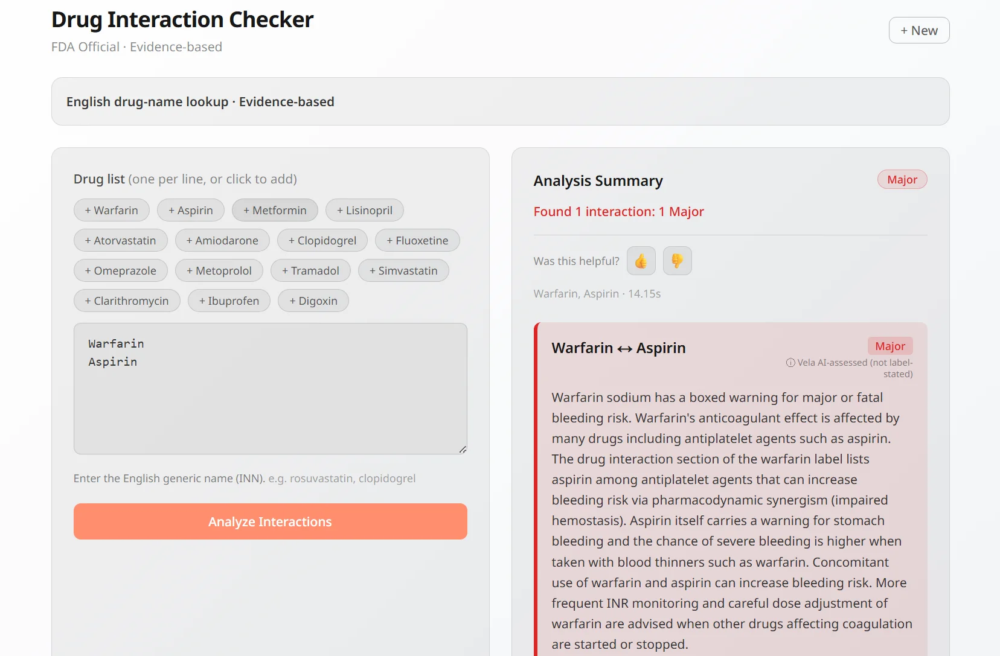
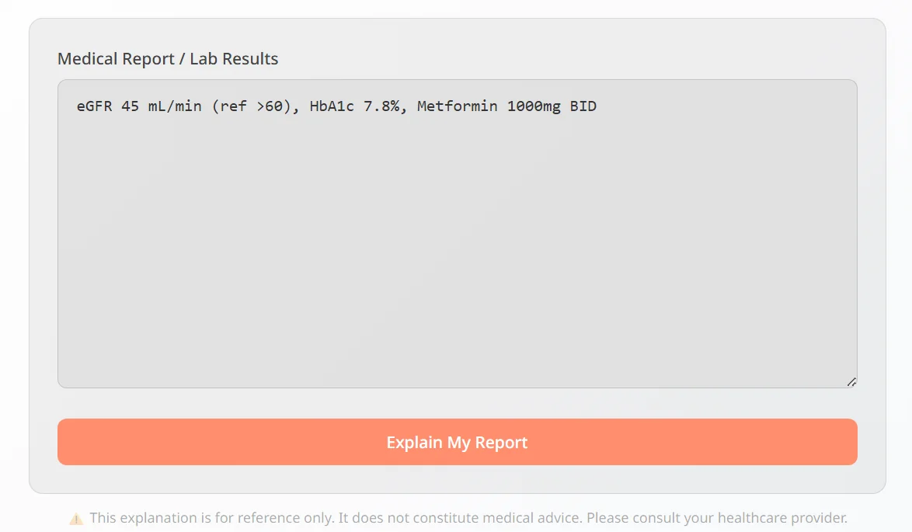
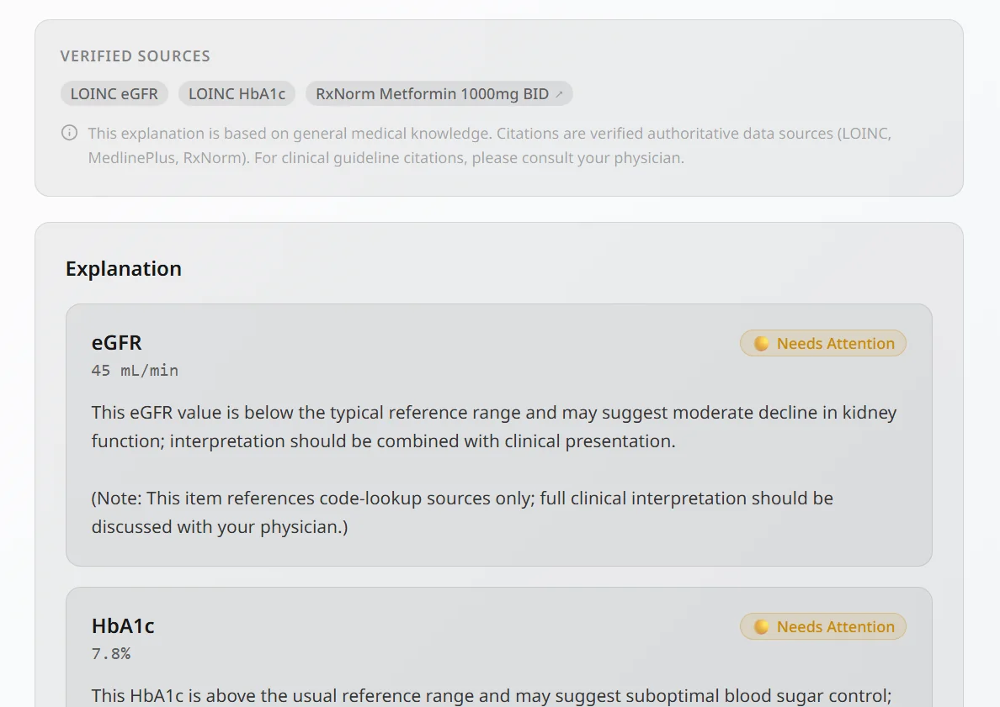

> **Status: archived (Oct 2026).** Vela is no longer developed. The hosted demo was shut down on
> **2026-11-04** — the Fly app was deleted to end hosting cost — and `vela.an-tho.com` now redirects to
> this repository. To see what Vela was, go to [See it](#-see-it); to try it, go to
> [Run it locally](#-run-it-locally). The project write-up is kept as
> [public/about/index.html](public/about/index.html) (HTML source).
>
> Vela is a research tool, **not a medical device**, and gives **no medical advice**. This code is provided
> **as-is, without warranty** of any kind (see [LICENSE](LICENSE)). **Secrets are not included** — the
> repository carries `.env.example` only; every key the app reads must be supplied by you.

# 🪸 Vela — Medical Research, Simplified.

> Evidence-based clinical answers from PubMed 36M+ literature and official FDA drug data.  
> Ask in any language — we search in English, answer in yours.

[](https://nextjs.org/)
[](https://fastapi.tiangolo.com/)
[](https://openai.com/)
[](LICENSE)

🌐 **Live demo:** retired 2026-11-04 — see [See it](#-see-it) below, or [run it locally](#-run-it-locally).

---

## 👀 See it

The hosted demo is gone. These are the product's own landing-page assets, kept in the repository.

**Research** — ask a clinical question, get a cited answer streamed back in your language:
[▶ public/media/research-demo.mp4](public/media/research-demo.mp4) (2.3 MB)

**Verify** — a drug-interaction check against FDA label data:



**Explain** — a lab report explained entity by entity, with source badges:





**Project write-up** — what Vela was, how it worked and what was measured:
[public/about/index.html](public/about/index.html) (HTML source; Traditional Chinese: [public/about/zh-TW.html](public/about/zh-TW.html)).

---

## ✨ Features

### 🔬 Research
Ask any clinical question in 16 languages. Vela retrieves from PubMed 36M+ articles and FDA drug data, then streams a cited, evidence-based answer back in the user's language.

### ✅ Verify
Check drug interaction safety for any combination of medications. Powered by FDA OpenFDA with structured severity ratings (Critical / Major / Moderate / Minor).

### 📋 Explain
Paste lab results, medical reports, or prescription data in any language. Vela identifies each entity, looks it up via LOINC, RxNorm, and MedlinePlus, then generates a plain-language explanation with source badges.

---

## 🏗️ Architecture

Three independent linear pipelines — not a multi-agent system:

```
Research:  User Query → Language Detect → HybridRetriever → NumPy Vector Search / PubMed / FDA → GPT-4.1 → SSE Stream
Verify:    Drug List  → FDA OpenFDA API → Structured Interaction Data → GPT-4.1-mini → Response
Explain:   Lab Report → Entity Extractor → LOINC / RxNorm / MedlinePlus → GPT-4.1 → SSE Stream
```

### Security Layers

| Layer | Protection |
|-------|-----------|
| PHI Detection | Multi-country patterns (TW/JP/US) — ID, phone, SSN, MRN |
| Prompt Injection | Regex pattern scan + Base64 decode + multilingual heuristics |
| Indirect Injection | LLM scan on retrieved content before generation |
| Intent Guard | GPT-4.1-mini classifies non-medical queries and blocks them |
| Input Length | 5,000 character hard limit |
| Auth | Clerk JWT on every API call |
| Rate Limiting | Per-IP per-endpoint throttling |
| Sensitive Files | `.env`, `.git`, `.gitignore` return 404 (blocked in catch-all route) |

---

## 🛠️ Tech Stack

| Layer | Technology |
|-------|-----------|
| Frontend | Next.js 14, TypeScript, Tailwind CSS |
| Auth | Clerk (Production instance) |
| Backend | FastAPI, Python 3.11 |
| AI | OpenAI GPT-4.1 / GPT-4.1-mini |
| Vector Search | NumPy (in-memory, 690 documents) |
| Data Sources | PubMed API, FDA OpenFDA, LOINC, RxNorm, MedlinePlus |
| Database | PostgreSQL via Neon (history + user usage) |
| Payments | Dodo Payments (Free: 10 credits/day, Pro $9.99/mo) |
| Analytics | PostHog |
| Streaming | SSE (Server-Sent Events) |
| Hosting | Fly.io (Tokyo region) |

---

## 📁 Project Structure

```
Vela/
├── api/                          # FastAPI backend
│   ├── server.py                 # Main server + all endpoints
│   ├── middleware/
│   │   ├── guards.py             # Prompt injection + intent detection
│   │   └── phi_handler.py        # PHI detection (TW/JP/US)
│   ├── rag/
│   │   ├── generator.py          # Answer generation + language injection
│   │   └── retriever.py          # HybridRetriever — NumPy + PubMed + FDA
│   ├── data_sources/
│   │   ├── fda_client.py
│   │   ├── loinc_client.py
│   │   ├── rxnorm_client.py
│   │   └── medlineplus_client.py
│   ├── services/
│   │   ├── usage_service.py      # Credit system (Free: 10/day, Pro: 100/day)
│   │   ├── cost_tracker.py       # API cost monitoring
│   │   ├── entity_extractor.py   # Lab/drug entity extraction
│   │   └── explain_service.py    # 3-stage Explain pipeline
│   ├── models/
│   │   ├── sql_models.py         # UserUsage, ChatHistory, ApiCostLog, WebhookEvent
│   │   ├── schemas.py
│   │   └── explain_schemas.py
│   ├── cache/
│   │   └── simple_cache.py       # 3-layer cache (memory → local DB → live API)
│   └── utils/
│       └── language_detector.py  # Unicode CJK + keyword heuristics
├── pages/                        # Next.js pages
│   ├── index.tsx                 # Landing Page (logged-out) + Dashboard (logged-in)
│   ├── research.tsx
│   ├── verify.tsx
│   ├── explain.tsx
│   ├── history.tsx
│   ├── faq.tsx                   # Public FAQ (15 Q&A, accordion)
│   ├── terms.tsx                 # Terms of Service (incl. Fair Use Policy)
│   ├── privacy.tsx
│   └── refund.tsx
├── components/
│   ├── CitationPanel.tsx
│   ├── FeedbackBar.tsx           # 👍👎 per-response feedback (Research/Verify/Explain)
│   ├── MobileNav.tsx             # Bottom tab bar (mobile)
│   └── UpgradeModal.tsx          # Paywall modal with ToS consent
├── scripts/
│   ├── build_drug_vectordb.py
│   └── build_explain_cache.py    # Pre-warm LOINC + RxNorm + MedlinePlus
├── tests/
│   ├── golden_dataset.json       # 89 test cases (74 active, 15 deprecated)
│   └── run_golden_tests.py       # LLM-as-Judge test runner v3.0
└── data/                         # gitignored
    ├── drug_database/            # Drug JSON files
    └── vector_store/             # NumPy vector store (.npy + metadata)
```

---

## 🚀 Run it locally

Vela is demoed by running it on your own machine. There is no Vela service left to call; every answer is
generated with **your** OpenAI key, at your cost. Line references are at the commit that retired the demo.

### What you need

| | Required? | Notes |
|---|---|---|
| Python 3.11+ · Node.js 18+ | yes | The hosted build ran on Python 3.12 / Node 22 (`Dockerfile`). |
| `OPENAI_API_KEY` | yes, for any answer | Not checked at startup — `api/providers/openai_provider.py:87-92` substitutes a placeholder and the first model call fails instead. Research, Verify and Explain all call OpenAI; **you pay for your own usage**. Model and provider names default in code (`api/providers/factory.py`), so the `*_MODEL` / `*_PROVIDER` rows in `.env.example` are optional overrides. |
| `SHARE_CREATED_BY_SALT` | yes, unless `TEST_MODE=true` | The only variable whose absence stops the backend: `api/server.py:398-407` raises `RuntimeError`. `TEST_MODE=true` supplies a built-in default. Generate one with `python -c "import secrets; print(secrets.token_urlsafe(32))"`. |
| `NEXT_PUBLIC_CLERK_PUBLISHABLE_KEY` | yes, for the frontend | `pages/_app.tsx:158-160` mounts `ClerkProvider` unconditionally and Clerk throws `Missing publishableKey` without one — also in the archive build, which shows no sign-in. A free Clerk development-instance key (`pk_test_…`) is enough; no Clerk secret is needed for anonymous Research. |
| `DATABASE_URL` | no | Unset → SQLite at `data/medinotes.db` (`api/database/sql_db.py:8`). Postgres is not required. Do **not** copy the Postgres placeholder from `.env.example`. |
| `ALLOWED_ORIGINS` | no | Unset → `http://localhost:3000` (`api/server.py:374-375`). Do **not** copy the placeholder from `.env.example`, it names the retired host. |
| `CLERK_SECRET_KEY` · `CLERK_JWKS_URL` | no, for anonymous use | Read only when a request carries a `Bearer` token (`api/server.py:421`). Signed-in flows also pin the token issuer and authorized party to the retired production host (`api/server.py:430-431`), so signed-in mode cannot run outside the original deployment without a code change. |
| `SENTRY_DSN` · `NEXT_PUBLIC_POSTHOG_KEY` · `DODO_*` · `ADMIN_USER_ID` · `FDA_API_KEY` · `PUBMED_API_KEY` | no | Sentry is disabled when unset (`api/server.py:49-54`); `posthog-js` logs a console error and stays inert without a key; payment and admin keys only serve routes a demo never hits; FDA and PubMed work keyless at lower rate limits. |
| `ANON_DAILY_BUDGET_USD` | no | Daily cap on aggregate anonymous spend; code default 2.00 USD (`api/services/cost_guard.py:12-31`). |

### What the backend does on start

- `Base.metadata.create_all` creates the tables in whatever `DATABASE_URL` points to (`api/server.py:272`). There is no migration framework.
- A retention sweep runs **immediately**, then daily: it **deletes** `audit_logs` and `chat_history` rows older than 180 days (`api/server.py:207-275`). Point a local run at a throwaway database, never at one you care about.

### Data files

- **Committed, loaded as-is:** `data/tfda/` (TFDA indication corpus + embeddings) and `data/dailymed/` (DailyMed label corpus) — Research's local sources (`api/database/vector_store.py:156-157`, `:211-212`). `data/drug_database/` (190 label JSONs) is also committed.
- **Not needed:** `data/drug_vectordb/index.json` is gitignored, and the local drug corpus it feeds is switched off (`enable_local=False`, `api/server.py:566-582`); a missing index is tolerated (`api/database/vector_store.py:42-45`). Do not run `scripts/build_drug_vectordb.py` — it would send 690 documents to the OpenAI embeddings API (7 requests of 100) for a corpus the app never reads.
- **Not useful:** `scripts/build_explain_cache.py` warms an in-memory cache (`api/cache/simple_cache.py:11-22`) inside its own process, so it warms nothing for the server. It makes no OpenAI call (247 requests to the free NLM LOINC / RxNorm / MedlinePlus APIs). Skip it; Explain looks terms up live on first use.
- **Per query:** each Research question also embeds the query once per local corpus (OpenAI embeddings) before the generation call.

### Auth modes

- **Anonymous Research** needs no Clerk key on the backend: the `X-Anon-Fingerprint` header stands in for a token (`api/server.py:510-517`), and the Research page sends it (`pages/research.tsx:322`).
- **`TEST_MODE=true`** skips Clerk JWT verification and rate limiting and treats token-less requests as `TEST_USER_ID` (default `test_user`) — `api/server.py:339`, `:389-392`, `:466-467`, `:522-523`. Guard: the process refuses to start when `FLY_APP_NAME` is also set (`:390-391`). Local use only.

### Archive build vs full build

- **Backend:** `ARCHIVE_MODE=true` → HTTP 410 on Verify, Explain, share and checkout routes; Research stays up and writes no history (`api/server.py:546-560`, `:1092`). Unset → the full product.
- **Frontend:** `NEXT_PUBLIC_ARCHIVE_MODE=true` at `next dev` / `next build` time → archive nav (Research + FAQ only, no sign-in or billing surfaces) via `utils/archiveMode.ts:8`. Unset → the full UI. The hosted demo ran the archive build (`fly.toml:14`, `:18`).

### Commands (Windows PowerShell)

Create a minimal `.env` in the repo root (both the backend, via `python-dotenv`, and Next.js read it):

```env
OPENAI_API_KEY=<your OpenAI key>
SHARE_CREATED_BY_SALT=<output of the python one-liner above>
NEXT_PUBLIC_CLERK_PUBLISHABLE_KEY=<pk_test_ key from a free Clerk development instance>
NEXT_PUBLIC_API_URL=http://localhost:8000
```

```powershell
# terminal 1 — backend, archive build (anonymous Research only)
pip install -r requirements.txt
$env:PYTHONIOENCODING="utf-8"; $env:ARCHIVE_MODE="true"
uvicorn api.server:app --port 8000

# terminal 2 — frontend, archive build
npm install
$env:NEXT_PUBLIC_ARCHIVE_MODE="true"
npm run dev
# open http://localhost:3000/research
```

For the full product (Verify, Explain, sign-in surfaces), omit both `ARCHIVE_MODE` variables. Verify then answers
anonymously too. Explain is gated to signed-in users (`api/server.py:1801-1803`), and sign-in cannot complete outside
the original deployment (see the Clerk rows above), so Explain is not reachable from this setup.

---

## 🧪 Testing

### Prerequisites

Ensure your `.env` has `DATABASE_URL` and `OPENAI_API_KEY` set.

### Running Tests (Windows PowerShell)

**Step 1 — Start backend in TEST_MODE** (skips Clerk JWT + rate limiting, auto-resets test_user credits):

```powershell
$env:TEST_MODE="true"; $env:PYTHONIOENCODING="utf-8"; uvicorn api.server:app --port 8000
```

**Step 2 — In a new terminal, run tests:**

```powershell
# Smoke test — fast, ~20 cases, daily use
$env:PYTHONIOENCODING="utf-8"; $env:TEST_MODE="true"; uv run python tests/run_golden_tests.py --smoke

# Full regression — 74 active cases, run before every deploy
$env:PYTHONIOENCODING="utf-8"; $env:TEST_MODE="true"; uv run python tests/run_golden_tests.py
```

**bash / Linux / macOS:**

```bash
# Start backend
TEST_MODE=true PYTHONIOENCODING=utf-8 uvicorn api.server:app --port 8000

# Smoke test
PYTHONIOENCODING=utf-8 TEST_MODE=true uv run python tests/run_golden_tests.py --smoke

# Full regression
PYTHONIOENCODING=utf-8 TEST_MODE=true uv run python tests/run_golden_tests.py
```

### Common Issues & Fixes

| Error | Cause | Fix |
|-------|-------|-----|
| `403` on all requests after a few tests | `test_user` hit free credit limit | TEST_MODE now auto-resets credits on start |
| `429` rate limit errors | Rate limiter firing in test mode | TEST_MODE now bypasses rate limiting |
| `Python-dotenv could not parse...` | Windows `.env` encoding issue | Safe to ignore — dotenv warning only, not an error |
| `Exit code 127: fly: command not found` | Fly CLI not in PATH | Use full path: `& "C:\Users\<you>\.fly\bin\fly.exe" deploy` |
| `PYTHONIOENCODING` emoji errors | Windows CP950 terminal encoding | Always set `PYTHONIOENCODING=utf-8` |

### Test Coverage

| Category | Active Cases | Scope |
|----------|-------------|-------|
| Research | 20 | English/Chinese/mixed clinical queries, edge cases |
| Verify | 15 | Drug interaction accuracy, severity ratings |
| Explain | 22 | Lab reports, multilingual (JA/KO/ES/FR/DE/IT/PT), edge cases |
| Guard | 17 | Injection attacks, non-medical queries, false positive check |
| Multilingual | 7 | JA/TH/KO/ES/ZH response language verification |
| ~~Document~~ | ~~15~~ | Deprecated endpoint — auto-skipped |

Pass threshold: **≥ 70%** overall. Exit code `1` if below threshold.

Results saved to `tests/results/golden_results_YYYYMMDD_HHMMSS.json` + HTML report.

---

## 🚢 Deployment

> Historical. The Fly app was deleted on 2026-11-04; `fly.toml` and `deploy.ps1` stay in the repo as the
> record of how it ran. `<your-domain>` below stood for the retired host.

### Deploy to Fly.io

```powershell
# Windows
& "C:\Users\<you>\.fly\bin\fly.exe" deploy

# bash
fly deploy
```

### Environment Variables on Fly.io

`NEXT_PUBLIC_*` variables must go in `fly.toml` `[build.args]` (build-time):

```toml
[build.args]
  NEXT_PUBLIC_CLERK_PUBLISHABLE_KEY = "pk_live_..."
  NEXT_PUBLIC_POSTHOG_KEY = "phc_..."
  NEXT_PUBLIC_POSTHOG_HOST = "https://app.posthog.com"
  NEXT_PUBLIC_API_URL = "https://<your-domain>"
```

All other secrets via `fly secrets set`:

```bash
fly secrets set \
  DATABASE_URL="postgresql://..." \
  OPENAI_API_KEY="sk-..." \
  CLERK_SECRET_KEY="sk_live_..." \
  CLERK_JWKS_URL="https://<your-clerk-frontend-api>/.well-known/jwks.json" \
  ALLOWED_ORIGINS="https://<your-domain>" \
  LEMON_SQUEEZY_API_KEY="..." \
  LEMON_SQUEEZY_SIGNING_SECRET="..." \
  LEMON_SQUEEZY_STORE_ID="318315"
```

### Recommended Deploy Flow

```
1. Make changes locally
2. npm run build  (verify no build errors)
3. Run smoke test (optional but recommended)
4. git add . && git commit -m "..." && git push origin main
5. fly deploy
6. Verify: curl https://<your-domain>/health
```

---

## 💰 Pricing Model

| Plan | Price | Credits | Usage |
|------|-------|---------|-------|
| Free | $0 | 10 credits/day | Research (3 credits), Explain (2), Verify (1) |
| Pro | $9.99/mo or $89.99/yr (save 25%) | 100 credits/day | All features |

*Subject to fair use policy. Daily limit of 100 credits applies to prevent automated abuse. Credit costs: Research (3), Verify (1), Explain (2). See [Terms of Service](pages/terms.tsx).

---

## 🔒 Security & Privacy

- **No PHI stored** — inputs are processed in memory only
- **Multi-country PHI detection** — Taiwan ID, Japan My Number, US SSN/MRN
- **Prompt injection protection** — pattern scan + Base64 decode + LLM classification
- **Sensitive file blocking** — `.env`, `.git`, `.gitignore` blocked at server level
- **For reference only** — not a substitute for professional clinical judgment

---

## 📄 License

MIT License — see [LICENSE](LICENSE)

---

## 📧 Contact

Andrew Lee · [@AndrewLee0430](https://github.com/AndrewLee0430)  
Support: support@an-tho.com  
Project: [https://github.com/AndrewLee0430/Vela](https://github.com/AndrewLee0430/Vela)

---

## 🙏 Acknowledgments

- [OpenAI](https://openai.com) — GPT-4.1
- [PubMed / NLM](https://pubmed.ncbi.nlm.nih.gov) — Medical literature (36M+ articles)
- [FDA OpenFDA](https://open.fda.gov) — Drug label data
- [LOINC®](https://loinc.org) — Lab test terminology (Regenstrief Institute, Inc.)
- [MedlinePlus](https://medlineplus.gov) — Consumer health information (NLM)
- [RxNorm](https://www.nlm.nih.gov/research/umls/rxnorm) — Drug name standardization (NLM)
- [Clerk](https://clerk.com) — Authentication
- [Neon](https://neon.tech) — Serverless PostgreSQL
- [Fly.io](https://fly.io) — Hosting (Tokyo region)
- [Dodo Payments](https://dodopayments.com) — Payments & subscriptions
- [PostHog](https://posthog.com) — Product analytics

> ⚠️ Vela is a clinical decision support tool for reference only. It does not replace professional medical judgment. All clinical decisions should be based on comprehensive clinical assessment by a qualified healthcare professional.

---

*Built with ❤️ for healthcare professionals*